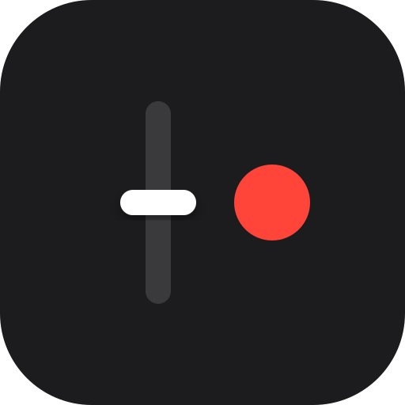
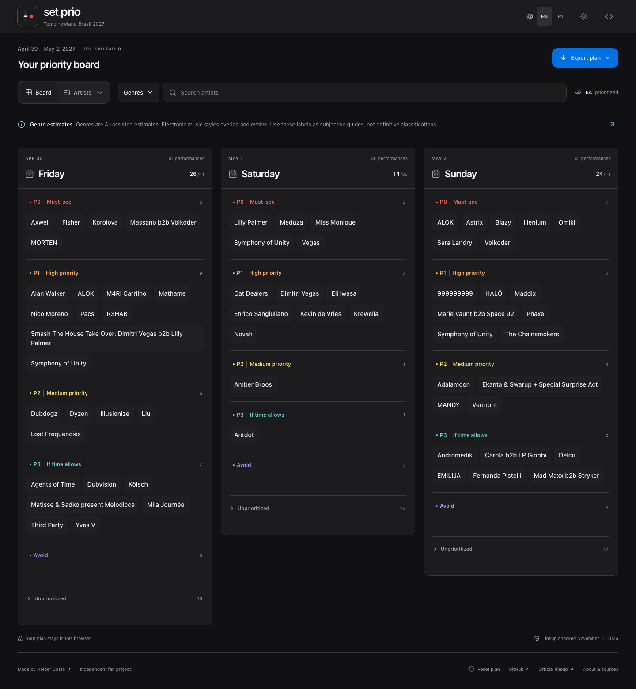
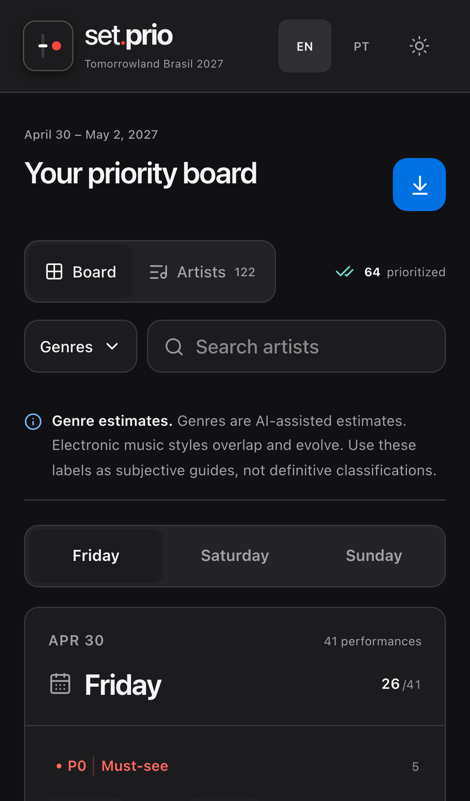
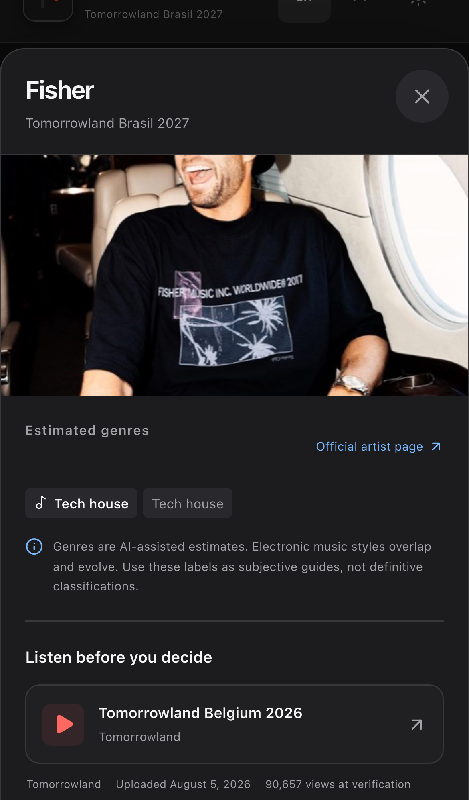
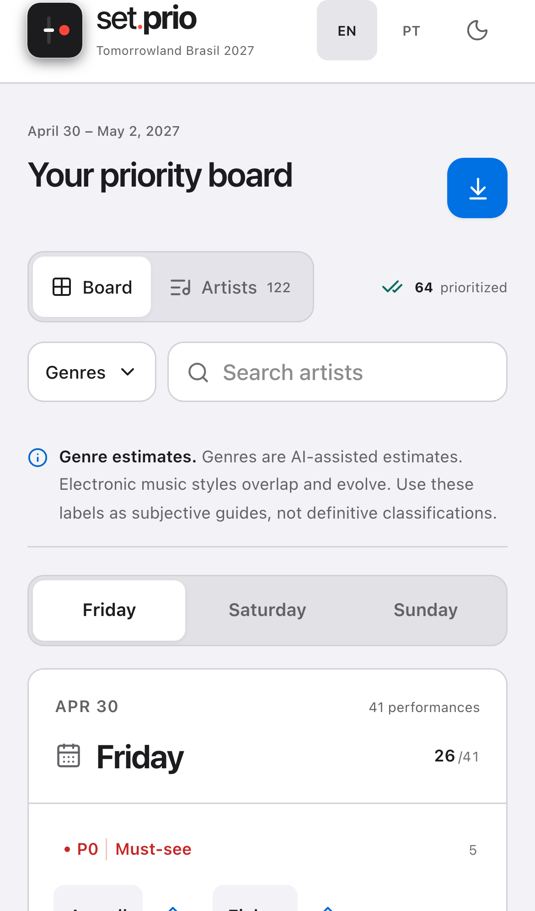

<div align="center">


[](https://react.dev)
[](https://tailwindcss.com)
[](https://vite.dev)
[](https://setprio.vercel.app)
[](https://github.com/heldercostaa)
[](https://linkedin.com/in/heldercostaa/)
[](https://github.com/heldercostaa/set.prio/stargazers)

<br />
<a href="https://setprio.vercel.app">
  
</a>
<h3 align="center" style="font-size: 3em;">set.prio</h3>
<p align="center">
  Discover artists, prioritize performances, and share your festival plan.
  <br />
  <a href="#local-setup-instructions"><strong>Run the project locally »</strong></a>
  <br />
  <br />
  <a href="https://setprio.vercel.app">Live Application</a>
  ·
  <a href="https://github.com/heldercostaa/set.prio/issues">Report a Bug</a>
</p>
</div>

> [!NOTE]
> Your plan stays in the current browser. No backend, account, or API keys are required.

<details>
  <summary>Table of Contents</summary>
  <ol>
    <li>
      <a href="#about-the-project">About The Project</a>
      <ul>
        <li><a href="#built-with">Built With</a></li>
      </ul>
    </li>
    <li><a href="#features">Features</a></li>
    <li><a href="#local-setup-instructions">Local Setup Instructions</a></li>
  </ol>
</details>

## About The Project

<div align="center">
  
</div>
<br />

set.prio is a personal planner for deciding which artists to see. Organize performances by priority, explore recommended recordings, and keep ratings and notes. The bundled artist catalog covers Tomorrowland Brasil.

<p align="center">
  
  
  
</p>

### Built With

[](https://react.dev)
[](https://www.typescriptlang.org)
[](https://vite.dev)
[](https://tailwindcss.com)
[](https://www.radix-ui.com)
[](https://motion.dev)
[](https://zustand.docs.pmnd.rs)

## Features

- Prioritize performances by day, with nearby floating drag targets
- Search artists and filter by multiple genres
- Preview sets, mark watched recordings with ratings, and keep comments
- Share the plan as a PNG, CSV, or Notion table
- English and Brazilian Portuguese, with dark and light appearances
- Browser-local saving and a confirmed reset action

## Local Setup Instructions

1. **Clone the Repository**:

   ```bash
   git clone https://github.com/heldercostaa/set.prio.git set-prio
   cd set-prio
   ```

2. **Install Dependencies**: Use the Node version in `.nvmrc` and pnpm version in `package.json`.

   ```bash
   nvm use
   pnpm install --frozen-lockfile
   ```

3. **Run Development Server**:

   ```bash
   pnpm dev
   ```

> [!TIP]
> Use `pnpm build` and `pnpm preview` to check the production build. Testing, catalog sources, and screenshot refresh commands are in the [development notes](./docs/development.md).
