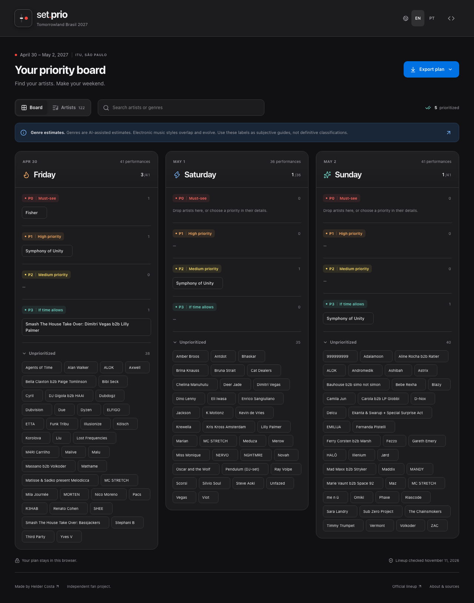
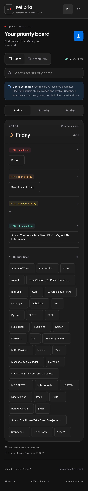
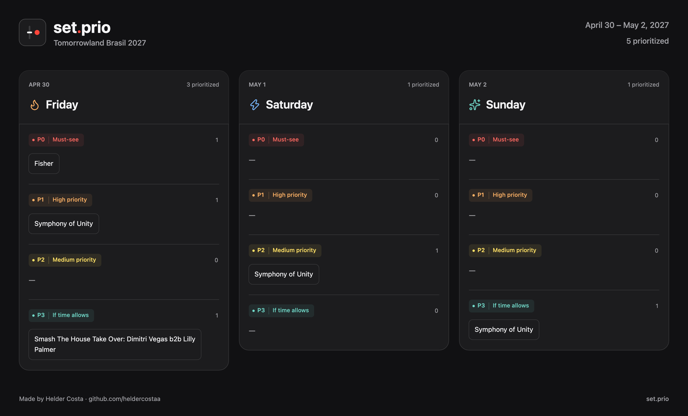

<p align="center">
  <a href="https://www.typescriptlang.org/"></a>
  <a href="https://react.dev/"></a>
  <a href="https://tailwindcss.com/"></a>
  <a href="https://vite.dev/"></a>
</p>

<br />

<p align="center">
  
</p>
<h1 align="center">set.prio</h1>
<p align="center">
  Your artists. Your priorities. Your weekend.<br />
  Tomorrowland Brasil 2027 · April 30–May 2
  <br /><br />
  <a href="#local-setup"><strong>Run locally »</strong></a>
  · <a href="./docs/catalog-research.md">Catalog sources</a>
  · <a href="./docs/verification.md">Verification</a>
</p>

<details>
  <summary>Table of contents</summary>
  <ol>
    <li><a href="#about-the-project">About the project</a></li>
    <li><a href="#built-with">Built with</a></li>
    <li><a href="#features">Features</a></li>
    <li><a href="#local-setup">Local setup</a></li>
    <li><a href="#commands">Commands</a></li>
    <li><a href="#architecture">Architecture</a></li>
    <li><a href="#catalog-and-sources">Catalog and sources</a></li>
    <li><a href="#browser-local-storage">Browser-local storage</a></li>
    <li><a href="#exports">Exports</a></li>
    <li><a href="#testing">Testing</a></li>
    <li><a href="#deployment">Deployment</a></li>
  </ol>
</details>

## About the project

A personal planner for Tomorrowland Brasil 2027. Discover artists, prioritize performances by day, rate recommended YouTube sets, and export your plan as an image, CSV, or Notion table. Preferences are saved locally in your browser; no account or backend required.



The board keeps official days fixed while you decide which performances matter most. The bundled snapshot contains 122 official artist entries, 113 billed acts, and 118 performances: 41 on Friday, 36 on Saturday, and 41 on Sunday. Collaboration-only artists do not receive invented solo slots.

This is an independent fan project. It has no runtime scraping, LLM calls, API keys, or server accounts.

## Built with

| Area                    | Technology                                         |
| ----------------------- | -------------------------------------------------- |
| Application             | React, TypeScript, Vite                            |
| Styling and interaction | Tailwind CSS, Radix UI, Motion, Lucide             |
| Browser state           | Zustand and versioned localStorage                 |
| Tooling                 | pnpm and Biome                                     |
| Verification            | Vitest, React Testing Library, Playwright, Gherkin |

Dependency versions and the package manager are pinned. The supplied SVG is the canonical icon; derived PNGs retain its original dark background, geometry, colors, and shadow.

## Features

### 1. Build your priority board

Organize each appearance into P0 Must-see, P1 High priority, P2 Medium priority, or P3 If time allows. Drag within its official day or use the priority selector. Clear a choice to return it to Unprioritized. Repeated appearances remain independent.

### 2. Discover artists and recordings

Search names and genres, open an artist preview or dialog, and listen to a researched full YouTube set. B2b details keep each member’s profile, genres, recording, and score separate. A score of zero is valid; an empty score means unrated.

**Genres are AI-assisted estimates.** Electronic music styles overlap and evolve. Use these labels as subjective guides, not definitive classifications.

### 3. Plan on your phone

A day selector replaces the three-column board on narrow screens. Every action works without hover or dragging. English is the first-visit default; Brazilian Portuguese and all edits persist in the current browser. The interface stays dark and respects reduced motion.

<details>
  <summary>View the mobile layout</summary>
  
</details>

### 4. Share your plan

Download the complete board as a PNG, export CSV, or copy a table with named recording links to Notion. All prioritized appearances are included, regardless of search or the active mobile day.



## Local setup

1. Install Node **24.16.0** and pnpm **11.25.0**.
2. Clone the repository:

   ```sh
   git clone https://github.com/heldercostaa/set.prio.git set-prio
   cd set-prio
   ```

3. Select the toolchain and install dependencies:

   ```sh
   nvm use
   corepack enable
   corepack prepare pnpm@11.25.0 --activate
   pnpm install --frozen-lockfile
   ```

4. Start the application:

   ```sh
   pnpm dev
   ```

Open the URL printed by Vite, normally http://127.0.0.1:5173. No environment variables, database, or credentials are required to run the app.

## Commands

| Command                | Purpose                                               |
| ---------------------- | ----------------------------------------------------- |
| `pnpm dev`             | Start the development server                          |
| `pnpm lint`            | Check lint rules                                      |
| `pnpm format:check`    | Check formatting                                      |
| `pnpm format`          | Apply formatting                                      |
| `pnpm typecheck`       | Check TypeScript                                      |
| `pnpm test`            | Run unit and component tests once                     |
| `pnpm test:e2e`        | Generate BDD tests and run all browser workflows      |
| `pnpm build`           | Type-check and build `dist/`                          |
| `pnpm preview`         | Serve the production bundle                           |
| `pnpm icons`           | Derive PNG icons from the canonical SVG               |
| `pnpm catalog:refresh` | Refresh official lineup data while retaining curation |

## Architecture

| Location                  | Responsibility                                                 |
| ------------------------- | -------------------------------------------------------------- |
| `src/app.tsx`             | Compose the planner and dialogs                                |
| `src/components/planner/` | Header, footer, toolbar, board, catalog, and export controls   |
| `src/components/ui/`      | Reusable accessible primitives                                 |
| `src/components/artist*`  | Artist previews, recordings, and appearance editing            |
| `src/styles/`             | Tokens, global foundations, and scoped compound selectors      |
| `src/data/`               | Bundled catalog, stable identities, and search                 |
| `src/store/`              | Versioned state and storage recovery                           |
| `src/i18n.ts`             | English and Brazilian Portuguese text and dates                |
| `src/utils/`              | Export selection, table encoding, clipboard, and PNG rendering |
| `features/`, `e2e/`       | Gherkin scenarios, browser steps, and regression workflows     |
| `scripts/`                | Icon generation and catalog refresh                            |

Components use Tailwind utilities. Scoped CSS handles compound states and browser adaptations. The interface adapts [Apple’s Human Interface Guidelines](https://developer.apple.com/design/human-interface-guidelines/) through Radix web primitives and system typography. It does not distribute Apple fonts or SF Symbols. See [design notes](./docs/design.md).

### Development workflow

`main` is the default integration branch. Start changes on a descriptive feature branch from the latest `origin/main`, then open a pull request. Keep each change reviewable. Do not push new work directly to `main` or merge without an explicit request. Repository instructions are in [AGENTS.md](./AGENTS.md). See the [main protection policy](./docs/main-protection.md) for the active GitHub ruleset and [merged branch cleanup](./docs/branch-cleanup.md) for automatic source-branch deletion.

## Catalog and sources

The [official lineup](https://brasil.tomorrowland.com/pt/line-up/?page=artists) determines billed names and performance days. Research runs during development. Sources and verification dates are bundled with the catalog.

```sh
pnpm catalog:refresh
pnpm typecheck
pnpm test
pnpm build
```

Review the diff and research newly announced artists. Stable IDs preserve curation and saved preferences. Portrait binaries remain outside localStorage.

Current gaps include unsupported genre estimates for six records, missing exact upload dates for 60 recordings, seven representative joint-act recordings, and unavailable artist-specific sets for MC STRETCH and Special Surprise Act. Stages and set times remain unknown. Two source date conflicts and a recording that may need YouTube sign-in are documented in the [research notes](./docs/catalog-research.md).

## Browser-local storage

Priorities and comments belong to appearance IDs; ratings belong to recording IDs. The key is `set.prio:brasil-2027:v1`. Catalog updates retain preferences even when an ID temporarily disappears. Each browser and device keeps its own plan; clearing site data removes it.

Malformed or unsupported saves are preserved under a `set.prio:brasil-2027:v1:backup:` key before a fresh plan opens. If backup fails, the original stays untouched and edits use temporary memory. To recover, copy the backup in browser developer tools, repair its JSON/schema, and replace the active value. Keep the backup until recovery is confirmed.

## Exports

All exports include prioritized appearances sorted by day, priority, then artist name.

- **PNG:** three complete day columns with branding, priorities, wrapped artist labels, dates, and credits. Comments and portraits are excluded.
- **CSV:** UTF-8 with a BOM, quoted fields, escaped quotes/newlines, and formula-like text neutralized. `At` includes both the event label and URL.
- **Notion:** HTML table with named YouTube links plus plain text. Clipboard failures open a selectable manual-copy table and offer CSV.

CSV and Notion use exactly: **Name, At, Day, Priority, Genre, Sub-genres, Rating, Comment**. B2bs expand into one row per artist, identifying the original joint billing in `Name`. Each row has that artist’s recording, genres, and score; day, priority, and comment are shared. PNGs keep the joint billing together.

## Testing

```sh
pnpm exec playwright install chromium webkit
pnpm test
pnpm test:e2e
```

Executable Gherkin scenarios cover persistent bilingual preferences, zero scores, multiline notes, and priority clearing. Browser regressions cover official-day restrictions, collaboration details, exports, clipboard payloads, focus, responsive layouts, and reduced motion. CI runs noninteractive checks and installs browser dependencies with `--with-deps`.

Mobile profiles emulate devices; they are not physical-device checks. Actual Notion paste behavior requires an authorized test page. See [verification results](./docs/verification.md) for evidence and limits.

## Deployment

```sh
pnpm install --frozen-lockfile
pnpm build
pnpm preview
```

Publish `dist/` to a static host using Node 24 and pnpm 11.25.0. For GitHub Pages, build with `pnpm build --base=/set.prio/`. Assets resolve through Vite’s base path. The production preview normally uses port 4173.

## Credits

Created by [Helder Costa](https://github.com/heldercostaa). Lineup, portrait, and recording sources are documented in the catalog research notes.

P4 **Avoid / Evitar** marks performances you do not want to attend. It is distinct from an unprioritized appearance and remains visible in the board and exports.

## Web Analytics

Vercel Web Analytics is mounted in production builds through `@vercel/analytics/react`. Development does not send page views. Planner comments, priorities, and recording scores are not sent as custom events.

Enable Web Analytics in the project's Vercel Analytics dashboard, then deploy this change. Verify production page views in that dashboard. See [Vercel's setup guide](https://vercel.com/docs/analytics/quickstart).
